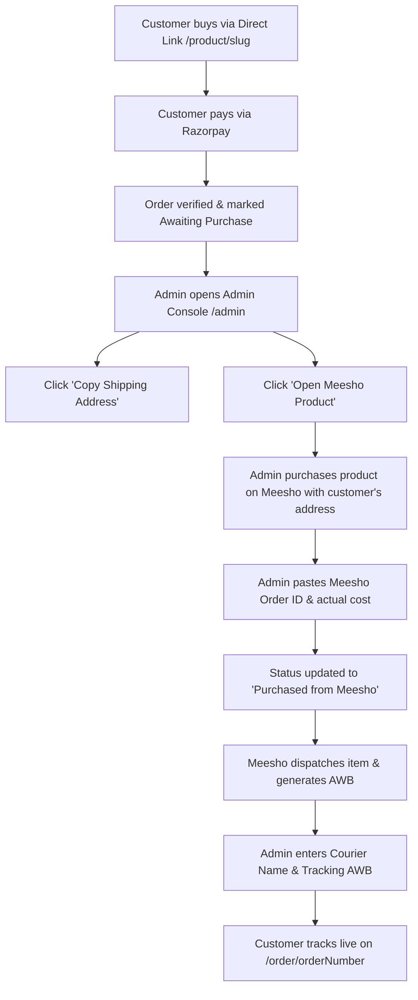

# Minimal E-Commerce with Manual Meesho Order Fulfillment

A modern, high-converting, direct-product-link selling platform engineered with **Next.js 16 (App Router)**, **TypeScript**, **Tailwind CSS**, **Supabase PostgreSQL**, and **Razorpay Payment Gateway**.

Designed specifically for marketing products sourced from Meesho via direct URLs (shared through WhatsApp, Instagram, Facebook, and targeted social media ads).

---

## 🌟 Key Highlights & Core Model

- **Direct-Product-Link Commerce**: Customers navigate directly to unique product funnels (`/product/[slug]`). No distracting multi-page browsing, carts, or wishlists.
- **Conversion-Optimized Product Detail Page**: Large image gallery with swipe & zoom, Indian PIN code delivery checker, size guide modal, urgency indicators, and sticky mobile "BUY NOW" action.
- **1-Page Guest Checkout**: Streamlined delivery address form with full Indian states dropdown, instant validation, and server-side authoritative price calculation.
- **Secure Razorpay Payment**: Authoritative server-side payment verification (HMAC SHA-256 signature verification) and idempotent webhook handling.
- **Private Order Tracking**: Zero data leakage. Order lookup strictly requires a private cryptographically random access token or customer phone verification.
- **Manual Meesho Fulfillment Workflow**:
  1. Customer orders on your site & pays securely via Razorpay.
  2. Order appears in Admin Dashboard under **Awaiting Purchase**.
  3. Admin clicks **"📋 Copy Shipping Address"** (one-click formatted address ready for Meesho).
  4. Admin clicks **"🔗 Open Meesho Product"** (opens the Meesho supplier page in a new browser tab).
  5. Admin places the order on Meesho using the customer's shipping details.
  6. Admin enters the Meesho Order ID, actual purchase cost, and courier tracking number.
  7. Profit is automatically calculated: `Selling Price − Meesho Cost − ~2% Gateway Fee`.
- **Zero-Config Dual Data Engine**: Works out-of-the-box with an in-memory/mock fallback store for instant local testing, while offering seamless integration with live Supabase PostgreSQL.

---

## 🛠️ Technology Stack

| Layer | Technologies |
|---|---|
| **Frontend** | Next.js 16 (App Router), React 19, TypeScript, Tailwind CSS |
| **Icons & UI** | Lucide Icons, Canvas Confetti, Framer Motion |
| **Backend & APIs** | Next.js Route Handlers, Zod Validation |
| **Database & Storage** | Supabase PostgreSQL, Row Level Security (RLS), Supabase Storage |
| **Payment Gateway** | Razorpay (UPI, Debit/Credit Cards, Net Banking, Webhooks) |
| **Security** | HTTP-Only Cookies, Cryptographic Order Access Tokens, HMAC SHA-256 Signature Verification |
| **Hosting** | Vercel & Supabase |

---

## 📁 Repository Structure

```
meeshoapp/
├── supabase/
│   ├── schema.sql              # Complete PostgreSQL schema, RLS policies & indexes
│   └── seed.sql                # Curated seed products with realistic pricing
├── src/
│   ├── app/
│   │   ├── page.tsx            # Direct link launcher & testing portal
│   │   ├── layout.tsx          # Root layout with Inter font & Razorpay script
│   │   ├── product/[slug]/     # Direct Product Detail Page
│   │   ├── checkout/           # 1-Page Guest Checkout
│   │   ├── order/[orderNumber]/# Customer Order Confirmation & Tracking
│   │   ├── track/              # Public Order Lookup by Number & Phone
│   │   ├── admin/              # Admin Console & Manual Meesho Fulfillment
│   │   │   └── login/          # Admin Authentication Portal
│   │   └── api/
│   │       ├── checkout/create-order/   # Authoritative order creation
│   │       ├── checkout/verify-payment/ # Razorpay signature verification
│   │       ├── webhooks/razorpay/       # Idempotent payment webhook
│   │       ├── orders/[orderNumber]/    # Secure customer order lookup
│   │       └── admin/                   # Metrics, orders, & product CRUD
│   ├── components/
│   │   ├── ui/                 # Reusable buttons, badges, toast notifications
│   │   ├── product/            # ProductView gallery, zoom, pincode check
│   │   ├── checkout/           # CheckoutView address form & payment flow
│   │   ├── order/              # OrderConfirmationView tracking timeline
│   │   └── admin/              # AdminDashboard & fulfillment modal
│   ├── lib/
│   │   ├── data/               # Unified data store & mock fallback
│   │   ├── supabase/           # Browser & Admin service-role clients
│   │   ├── razorpay.ts         # Razorpay SDK client & signature verifier
│   │   ├── auth.ts             # Admin cookie session validation
│   │   └── utils.ts            # Formatting (INR currency, tokens, slugs)
│   └── types/                  # TypeScript interfaces & Zod schemas
├── .env.example                # Documented environment variables
└── README.md
```

---

## 🚀 Getting Started Locally

### 1. Clone & Install Dependencies

```bash
cd d:/meeshoapp
npm install
```

### 2. Configure Environment Variables

Copy `.env.example` to `.env.local`:

```bash
cp .env.example .env.local
```

> **Note:** The application comes pre-configured with default development credentials so you can run and test the complete workflow immediately without external accounts.

### 3. Run Development Server

```bash
npm run dev
```

Open [http://localhost:3000](http://localhost:3000) in your browser.

- **Direct Product Link**: [http://localhost:3000/product/royal-emerald-embroidered-anarkali-kurti-set](http://localhost:3000/product/royal-emerald-embroidered-anarkali-kurti-set)
- **Admin Console**: [http://localhost:3000/admin](http://localhost:3000/admin)
- **Default Admin Credentials**:
  - Email: `admin@meeshoapp.com`
  - Password: `admin123`

---

## 🗄️ Supabase PostgreSQL Setup

When you are ready to connect to your live Supabase cloud database:

1. Create a new project at [supabase.com](https://supabase.com).
2. Go to **SQL Editor** in the Supabase Dashboard.
3. Open `supabase/schema.sql` from this repository, copy its contents, and execute it.
4. (Optional) Run `supabase/seed.sql` to populate sample Meesho products.
5. In your Supabase Project Settings → **API**:
   - Copy **Project URL** into `NEXT_PUBLIC_SUPABASE_URL`
   - Copy **anon / public key** into `NEXT_PUBLIC_SUPABASE_ANON_KEY`
   - Copy **service_role key** (secret) into `SUPABASE_SERVICE_ROLE_KEY`

---

## 💳 Razorpay Payment Gateway Setup

1. Sign up / log in to [dashboard.razorpay.com](https://dashboard.razorpay.com).
2. Navigate to **Account & Settings** → **API Keys** and generate Test/Live keys.
3. Add the keys to `.env.local`:
   ```env
   NEXT_PUBLIC_RAZORPAY_KEY_ID=rzp_live_yourKeyId
   RAZORPAY_KEY_ID=rzp_live_yourKeyId
   RAZORPAY_KEY_SECRET=your_razorpay_key_secret
   ```
4. **Webhooks Setup**:
   - In Razorpay Dashboard, go to **Webhooks** → **Add New Webhook**.
   - **Webhook URL**: `https://your-domain.com/api/webhooks/razorpay`
   - **Secret**: Set a random secret and copy to `RAZORPAY_WEBHOOK_SECRET`.
   - **Active Events**: Check `payment.captured`, `order.paid`, and `payment.failed`.

---

## 📦 Manual Meesho Order Fulfillment Workflow (SOP)



### Step-by-Step Instructions:

1. **Customer Order Received**: The customer lands on your product page from WhatsApp or an ad, completes single-page checkout, and pays via Razorpay.
2. **Open Order in Admin**: Navigate to `/admin` → **Orders & Fulfillment**.
3. **Copy Shipping Address**: Click **"Fulfill"** on the paid order. Click **"📋 Copy Shipping Address"**. This copies the formatted customer name, phone number, address, city, state, and pincode.
4. **Open Meesho Product**: Click **"🔗 Open Meesho Product"** to open the exact supplier link in a new browser tab.
5. **Place Order on Meesho**: Add the selected variant to cart on Meesho. Paste the customer's shipping address. Complete checkout on Meesho.
6. **Record Details**: Return to the admin panel. Enter the **Meesho Order ID** (e.g. `MEESHO-891024`) and the **Actual Purchase Cost**. Click **"Mark as Purchased from Meesho"**.
7. **Add Tracking When Dispatched**: When Meesho notifies you of courier pickup, copy the courier name (e.g. *Delhivery*, *Shadowfax*) and tracking number into the order details. Click **"Update Tracking & Mark Shipped"**.
8. **Customer Notification**: The customer can view live updates on their secure tracking link (`/order/[orderNumber]?token=[token]`) at any time.

---

## 🔒 Security Architecture

- **Authoritative Pricing**: Unit prices and amounts are retrieved server-side from the database during order initialization. Client-submitted prices are never trusted.
- **HMAC SHA-256 Signature Verification**: Razorpay payment signatures are validated cryptographically on the server before an order is marked as `paid`.
- **Confidential Supplier Data**: Meesho product URLs, supplier IDs, expected purchase costs, and profit margins are strictly hidden from customers.
- **Secure Customer Order Lookup**: Customer orders cannot be enumerated. Access requires a matching cryptographically generated `order_access_token` or phone verification.
- **Admin Session Security**: Protected via HTTP-only, secure cookies with JWT-style cryptographic tokens.

---

## 🌐 Deployment to Vercel

1. Push your repository to GitHub:
   ```bash
   git add .
   git commit -m "feat: complete minimal e-commerce with manual Meesho fulfillment"
   git push origin main
   ```
2. Import the repository into [Vercel](https://vercel.com).
3. Under **Environment Variables**, add the variables from `.env.example`.
4. Click **Deploy**.

---

## 📄 License

MIT © 2026. Built with precision for direct-to-consumer e-commerce.
